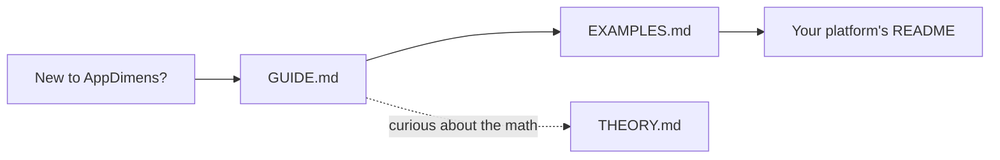

# AppDimens documentation

Welcome! This folder explains AppDimens for **every platform at once**. Code for a specific platform lives in that platform's own repository — the pages here tell you where to go.

> All AppDimens libraries are **in production** — version **3.2.0** (Web **3.2.1**, .NET **3.6.1**).

---

## Where should I start?

| I want to… | Read | Time |
|------------|------|------|
| Understand AppDimens and choose what to install | [GUIDE.md](GUIDE.md) — beginner's guide | 10 min |
| Copy working code for my platform | [EXAMPLES.md](EXAMPLES.md) | 2 min |
| See how a feature is written on each platform | [PLATFORMS.md](PLATFORMS.md) | 5 min |
| Upgrade from an older version | [MIGRATION.md](MIGRATION.md) | 5 min |
| Handle rotation, split screen, foldables | [ORIENTATION.md](ORIENTATION.md) | 5 min |
| Understand the math behind each strategy | [THEORY.md](THEORY.md) | 30+ min |

---

## Visual material

- **Interactive comparisons:** [html/SCALING_COMPARISON_COMPLETE.html](html/SCALING_COMPARISON_COMPLETE.html) · [html/SCALING_COMPARISON_2.html](html/SCALING_COMPARISON_2.html) ([about](html/README.md))
- **Papers (PDF):** [Precision scaling](AppDimens_Precision_Scaling.pdf) · [Android scaling](AppDimens_Precision_Android_Scaling.pdf) · [UI scaling](AppDimens_Precision_UI_Scaling.pdf) · [Beyond DP](Beyond_DP_Scaling.pdf)
- **Images:** [../IMAGES/README.md](../IMAGES/README.md)

---

## Glossary (plain words)

| Word | Meaning |
|------|---------|
| **dp / pt / px** | The usual units apps use for sizes. They keep sizes physically constant, so they look small on big screens. |
| **sdp** | "Scalable dp": a size that follows the **smallest side** of the screen. `16.sdp` = 16 on a 300-wide reference phone. |
| **ssp** | The same idea for **text**; respects the user's font-size setting. |
| **sem** | Text that **ignores** the user's font-size setting. |
| **wdp / hdp** | Sizes that follow the screen **width** / **height**. |
| **Strategy** | The rule used to grow a size: `scaled` (proportional), `auto` (proportional, then calmer), `fluid`, `percent`… See [GUIDE.md](GUIDE.md#5-which-strategy-should-i-choose). |
| **Prefix** | Letters before the name that pick the strategy: `a`sdp = auto, `f`sdp = fluid, `log`sdp = logarithmic… |
| **Suffix / ending** | Letters after the name that tweak it: `a` (screen shape), `i` (ignore split screen), `Px` (pixels), `Ph`/`Lw` (rotation). |
| **Inverter** | An ending (`Ph`, `Lw`, …) that changes which side of the screen is measured when the device rotates. See [ORIENTATION.md](ORIENTATION.md). |
| **Reference screen** | The 300 × 533 design canvas all calculations start from. |
| **auto turning point** | 480: up to this width `auto` grows like `scaled`, then slows down. |
| **SDP / SSP resources** | Ready-made Android `@dimen/_16sdp` / `@dimen/_14ssp` values from `appdimens-sdps` / `appdimens-ssps`. |
| **BOM** | A Gradle "bill of materials" that keeps all AppDimens modules on the same version. |
| **Skill** | Instructions that teach AI coding assistants to use a library correctly. Hub skill: [../skills/SKILL.md](../skills/SKILL.md). |
| **Old names** | BALANCED = `auto`, DEFAULT/FIXED = `scaled`, PERCENTAGE/DYNAMIC = `percent`. See [MIGRATION.md](MIGRATION.md). |

---

[← Hub README](../README.md) · [Guide](GUIDE.md) · [Examples](EXAMPLES.md) · [Platforms](PLATFORMS.md) · [Migration](MIGRATION.md) · [Orientation](ORIENTATION.md) · [Theory](THEORY.md)

