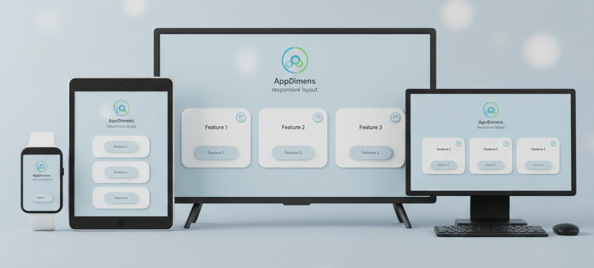
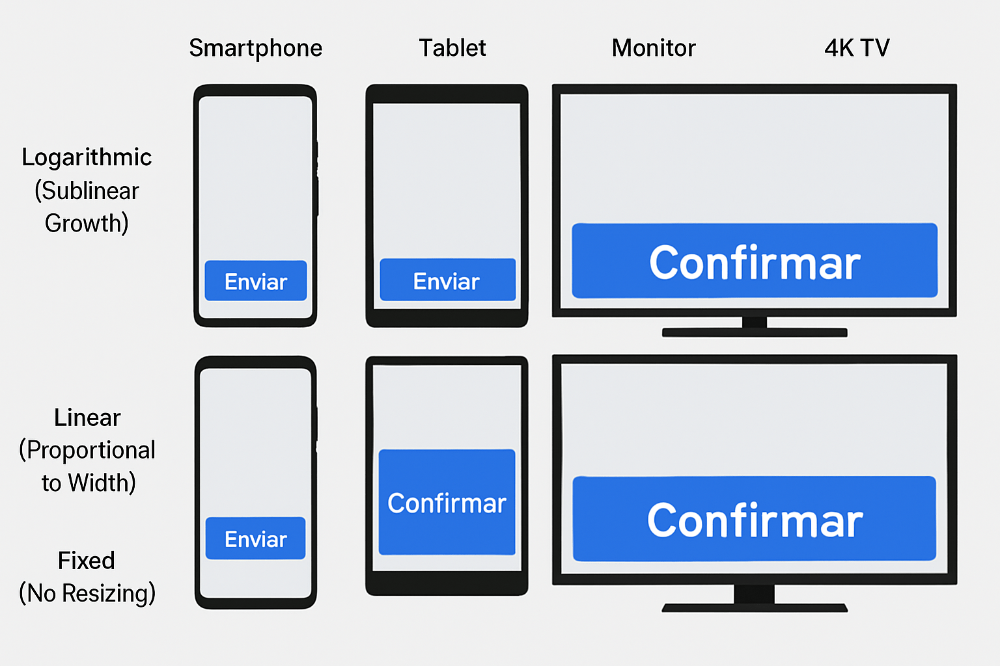

<div align="center">
   

# AppDimens — Sizes That Look Right on Every Screen

**Write `16` once. AppDimens makes it look the right size on phones, tablets, foldables, TVs, desktops and the web.**

[](#-pick-your-platform)
[](#-pick-your-platform)
[](LICENSE)
[](#-pick-your-platform)

[](DOCS/GUIDE.md)
[](DOCS/EXAMPLES.md)
[](DOCS/README.md)

🇧🇷 [Resumo em português](#-resumo-em-português)

</div>

---

## 🤔 What is AppDimens? (1 minute)

When you build an app, you write sizes like *"padding 16"* or *"text 18"*. The problem: **16 looks fine on a phone, tiny on a tablet and almost invisible on a TV.**

AppDimens fixes that. Instead of `16.dp` you write **`16.sdp`** (or `sdp(16)`, or `16sdp`, depending on your platform). The library looks at the screen the app is running on and **adjusts the number for you** — automatically, every time the screen changes (rotation, split screen, folding).

```text
You write:   16.sdp
Phone   →    19 dp   ✅ comfortable
Tablet  →    38 dp   ✅ same proportion
TV      →    58 dp   ✅ still readable
```

- ✅ **Same names on every platform** — `sdp`, `ssp`, `asdp`… mean the same thing on Android, iOS, Flutter, React Native, Web and .NET.
- ✅ **Production-ready** — every library below is published and stable.
- ✅ **Tiny and fast** — a calculation takes a few nanoseconds.
- ✅ **Free and open source** — Apache 2.0.

> [!TIP]
> **Too long, didn't read:** pick your platform in the table below, install one package, replace `16.dp` with `16.sdp` and `16.sp` with `16.ssp`. Done.

---

## 🖼️ The problem, in one picture

A **48 dp button** on different screens:

| Approach | Phone (360 dp) | Tablet (720 dp) | TV (1080 dp) | Result |
|----------|----------------|-----------------|--------------|--------|
| Plain `dp` / `sp` / `pt` / `px` | 48 (13% of the screen) ✅ | 48 (6.7%) ❌ tiny | 48 (4.4%) ❌ lost | Same number, shrinks visually |
| Simple proportional scaling | 58 (16%) ✅ | 115 (16%) ❌ huge | 173 (16%) ❌ giant | Grows too much |
| **AppDimens `auto`** | **58 (16%)** ✅ | **88 (12%)** ✅ | **98 (9%)** ✅ | Grows, but calmly — looks right everywhere |

<div align="center">
   
</div>

---

## 📦 Pick your platform

Every platform has its **own repository** (linked below). This repository is the **hub**: it brings them all together and explains the shared ideas.

| I'm building with… | Library | Version | Install | Start here |
|--------------------|---------|:-------:|---------|------------|
| **Android** — Jetpack Compose, Kotlin, Java | [appdimens-dynamic](https://github.com/bodenberg/appdimens-dynamic) | **3.2.0** | `implementation("io.github.bodenberg:appdimens-dynamic:3.2.0")` | [Beginner guide](https://github.com/bodenberg/appdimens-dynamic/blob/main/GUIDE-FOR-BEGINNERS.md) |
| **Android** — XML layouts (`@dimen/_16sdp`) | [appdimens-sdps](https://github.com/bodenberg/appdimens-sdps) | **3.2.0** | `implementation("io.github.bodenberg:appdimens-sdps:3.2.0")` | [README](https://github.com/bodenberg/appdimens-sdps/blob/main/README.md) |
| **Android** — XML text sizes (`@dimen/_14ssp`) | [appdimens-ssps](https://github.com/bodenberg/appdimens-ssps) | **3.2.0** | `implementation("io.github.bodenberg:appdimens-ssps:3.2.0")` | [README](https://github.com/bodenberg/appdimens-ssps/blob/main/README.md) |
| **Kotlin Multiplatform** — Android, iOS, desktop, web | [appdimens-kmp](https://github.com/bodenberg/appdimens-kmp) | **3.2.0** | `implementation("io.github.bodenberg:appdimens-kmp:3.2.0")` | [Beginner guide](https://github.com/bodenberg/appdimens-kmp/blob/main/GUIDE-FOR-BEGINNERS.md) |
| **Apple** — iOS, iPadOS, macOS, tvOS, watchOS, visionOS (SwiftUI, UIKit) | [appdimens-ios](https://github.com/bodenberg/appdimens-ios) | **3.2.0** | Swift Package Manager: `https://github.com/bodenberg/appdimens-ios` from `3.2.0` | [Beginner guide](https://github.com/bodenberg/appdimens-ios/blob/main/GUIDE-FOR-BEGINNERS.md) |
| **Flutter** — Android, iOS, web, desktop | [appdimens-flutter](https://github.com/bodenberg/appdimens-flutter) | **3.2.0** | `flutter pub add appdimens_flutter` | [Beginner guide](https://github.com/bodenberg/appdimens-flutter/blob/main/GUIDE-FOR-BEGINNERS.md) |
| **React Native** — iOS & Android | [appdimens-react-native](https://github.com/bodenberg/appdimens-react-native) | **3.2.0** | `npm install appdimens-react-native` | [Docs](https://github.com/bodenberg/appdimens-react-native/blob/main/docs/README.md) |
| **Web** — HTML/CSS, React, Vue, Svelte, Angular | [appdimens-web](https://github.com/bodenberg/appdimens-web) (npm `webdimens`) | **3.2.1** | `npm install webdimens` | [Getting started](https://github.com/bodenberg/appdimens-web/blob/main/docs/getting-started.md) · [PT-BR](https://github.com/bodenberg/appdimens-web/blob/main/docs/pt-BR/getting-started.md) |
| **.NET** — MAUI, WPF, WinForms, WinUI 3, .NET for Android | [appdimens-net-binding](https://github.com/bodenberg/appdimens-net-binding) | **3.6.1** | `dotnet add package Bodenberg.AppDimens.Maui.Sdps` | [Docs](https://github.com/bodenberg/appdimens-net-binding/blob/main/docs/README.md) |
| **Games** — Android, C/C++/NDK, OpenGL ES, Vulkan, Unity/C# | [appdimens-games](https://github.com/bodenberg/appdimens-games) | **3.2.0** | `implementation("io.github.bodenberg:appdimens-games:3.2.0")` | [Beginner guide](https://github.com/bodenberg/appdimens-games/blob/main/DOCUMENTATION/GUIDE-FOR-BEGINNERS.md) |

> [!NOTE]
> All libraries are **in production**. Android, KMP and Games are on **Maven Central**, Flutter on **pub.dev**, React Native and Web on **npm**, .NET on **NuGet**, iOS via **Swift Package Manager**. Each repository's README is the final word on its install line.

---

## 🚀 Your first line of code

The same idea — *16 of spacing, 18 of text* — on each platform:

**Android (Compose) · Kotlin Multiplatform**
```kotlin
import com.appdimens.dynamic.compose.*   // KMP: com.appdimens.kmp.compose.*

Text("Hello", fontSize = 18.ssp, modifier = Modifier.padding(16.sdp))
```

**Android (XML)** — with `appdimens-sdps` + `appdimens-ssps`
```xml
<TextView
    android:padding="@dimen/_16sdp"
    android:textSize="@dimen/_18ssp" />
```

**iOS (SwiftUI)**
```swift
import AppDimensDynamic

Text("Hello").font(.system(size: 18.ssp)).padding(16.sdp)
// Install once per window: ContentView().appDimens()
```

**Flutter**
```dart
import 'package:appdimens_flutter/appdimens.dart';

Padding(padding: EdgeInsets.all(16.sdp), child: Text('Hello', style: TextStyle(fontSize: 18.ssp)));
// Wrap your app once: AppDimensApp(child: MaterialApp(...))
```

**React Native**
```tsx
import { sdp, ssp } from 'appdimens-react-native';

<Text style={{ padding: sdp(16), fontSize: ssp(18) }}>Hello</Text>
```

**Web**
```html
<!-- No build step: the CDN script installs itself -->
<script src="https://cdn.jsdelivr.net/npm/webdimens@3.2.1/dist/webdimens.global.js"></script>
<p class="p:16sdp fs:18ssp">Hello</p>
<!-- With npm: import { install } from 'webdimens'; install(); -->
```

**.NET MAUI (XAML)**
```xml
<Label Text="Hello" Padding="{sdp:16}" FontSize="{ssp:18}" />
```

More complete, copy-paste examples for every platform: **[DOCS/EXAMPLES.md](DOCS/EXAMPLES.md)**.

---

## 🧭 Which "strategy" should I use?

A **strategy** is just the rule used to grow a size. You choose it by the **name** you type. Most people only ever need the first two:

| If your app… | Use | Example | What it does |
|--------------|-----|---------|--------------|
| Runs mostly on phones (the normal case) | **scaled** | `16.sdp`, `16.ssp` | Grows in proportion to the screen. |
| Runs on phones **and** tablets/TVs | **auto** ⭐ | `16.asdp`, `16.assp` | Grows normally on phones, then slows down on big screens. |
| Needs a size that is a % of the screen | percent | `16.psdp`, `10.spaceW` | Literal percentage of width/height. |
| Needs text between a minimum and a maximum | fluid | `16.fsdp`, `16.fssp` | Grows only inside a band (like CSS `clamp()`). |
| Targets very large TVs | logarithmic | `16.logsdp` | Grows very slowly. |
| Is a game or canvas | fit / fill | `16.ftsdp`, `16.flsdp` | Letterbox (never crop) or cover (always fill). |
| Needs real-world sizes | units | `10.mm`, `1.inch` | Physical millimetres, centimetres, inches. |

There are 14 strategies in total (also `power`, `interpolated`, `diagonal`, `perimeter`, `density`, `resize`). They are all explained in plain language in the **[Beginner guide](DOCS/GUIDE.md)**.

**Handy letters you can add at the end of any name:**

| Ending | Meaning | Example |
|--------|---------|---------|
| `a` | Also consider the screen shape (long/wide screens) | `16.sdpa` |
| `i` | Ignore split-screen/multi-window | `16.sdpi` |
| `Px` | Give me pixels instead of dp/points | `16.sdpPx` |
| `Ph`, `Lw`… | Switch the measured side when the device rotates | `32.sdpPh` |

`sdp` = scales with the **smallest side** of the screen · `wdp` = with the **width** · `hdp` = with the **height** · `ssp` = for **text** (respects the user's font size) · `sem` = for text that **ignores** the user's font size.

---

## 🤖 AI coding assistants (skills)

Each library ships a **skill** — a set of instructions that teaches AI coding assistants (Claude Code, Cursor, Copilot…) how to use it correctly.

| Where | Skill |
|-------|-------|
| This hub (routes to the right library) | [`skills/SKILL.md`](skills/SKILL.md) |
| Android Compose | [appdimens-dynamic/skills](https://github.com/bodenberg/appdimens-dynamic/tree/main/skills) |
| Kotlin Multiplatform | [appdimens-kmp/skills](https://github.com/bodenberg/appdimens-kmp/tree/main/skills) |
| iOS | [appdimens-ios/skills/appdimens-ios](https://github.com/bodenberg/appdimens-ios/tree/main/skills/appdimens-ios) |
| Flutter | [appdimens-flutter/skills](https://github.com/bodenberg/appdimens-flutter/tree/main/skills) |
| React Native | [appdimens-react-native/skills](https://github.com/bodenberg/appdimens-react-native/tree/main/skills) |
| Web | [appdimens-web/skills](https://github.com/bodenberg/appdimens-web/tree/main/skills) |
| .NET | [appdimens-net-binding/skill](https://github.com/bodenberg/appdimens-net-binding/tree/main/skill) |
| Games | [appdimens-games/skills](https://github.com/bodenberg/appdimens-games/tree/main/skills) |

For AI tools that read a summary file, see [`LLMS.txt`](LLMS.txt).

---

## 📚 Documentation

| I want to… | Read |
|------------|------|
| Get started step by step | [DOCS/GUIDE.md](DOCS/GUIDE.md) |
| Copy working code | [DOCS/EXAMPLES.md](DOCS/EXAMPLES.md) |
| See the same feature on every platform | [DOCS/PLATFORMS.md](DOCS/PLATFORMS.md) |
| Upgrade from an older version | [DOCS/MIGRATION.md](DOCS/MIGRATION.md) |
| Handle rotation and foldables | [DOCS/ORIENTATION.md](DOCS/ORIENTATION.md) |
| Understand the math | [DOCS/THEORY.md](DOCS/THEORY.md) |
| See pictures and comparisons | [IMAGES/README.md](IMAGES/README.md) · [interactive comparison](DOCS/html/SCALING_COMPARISON_COMPLETE.html) |
| Read the papers (PDF) | [Precision scaling](DOCS/AppDimens_Precision_Scaling.pdf) · [Android](DOCS/AppDimens_Precision_Android_Scaling.pdf) · [UI](DOCS/AppDimens_Precision_UI_Scaling.pdf) · [Beyond DP](DOCS/Beyond_DP_Scaling.pdf) |

---

## ❓ FAQ

**Do I need to learn math to use it?** No. Replace `dp` with `sdp` and `sp` with `ssp`. The math is there if you are curious ([THEORY.md](DOCS/THEORY.md)).

**What is a "design base"?** Sizes are designed for a reference phone **300 units wide**. On that phone `16.sdp` is exactly 16. Wider screens get proportionally more.

**Does it respect the user's font-size accessibility setting?** Yes — `ssp` does. Use `sem` only when text must *not* follow it (e.g. inside a fixed badge).

**Will it slow my app down?** No. Values are cached; one lookup costs a few nanoseconds ([performance report](https://github.com/bodenberg/appdimens-dynamic/blob/main/PERFORMANCE.md)).

**Does it work with rotation, split screen and foldables?** Yes, values update automatically. Add `i` (`16.sdpi`) if a value must ignore split screen.

**XML or Compose on Android?** Both. `appdimens-sdps`/`appdimens-ssps` give ready-made `@dimen` resources for XML; `appdimens-dynamic` is for Compose and code. Many apps use both.

**Can I mix platforms in one design system?** Yes — that's the point. A designer's "16 sdp" means the same on Android, iOS, Flutter, React Native, Web and .NET.

**Where do I report a bug?** In the repository of the library you use (e.g. [appdimens-flutter issues](https://github.com/bodenberg/appdimens-flutter/issues)). Problems with this hub's docs → [hub issues](https://github.com/bodenberg/appdimens/issues).

---

## 🗂️ How this repository is organised

This hub includes every library as a **Git submodule** (a link to another repository, pinned to its latest version).

```text
appdimens/                   ← you are here (the hub: docs + shared ideas)
├── DOCS/                    ← guides, examples, theory, migration
├── skills/                  ← AI assistant skill for the whole family
├── appdimens-dynamic/       ← Android Compose / Kotlin / Java
├── appdimens-sdps/          ← Android XML sizes
├── appdimens-ssps/          ← Android XML text sizes
├── appdimens-kmp/           ← Kotlin Multiplatform
├── appdimens-ios/           ← Apple platforms
├── appdimens-flutter/       ← Flutter
├── appdimens-react-native/  ← React Native
├── appdimens-web/           ← Web (npm: webdimens)
├── appdimens-net-binding/   ← .NET (MAUI, WPF, WinForms, WinUI, Android)
└── appdimens-games/         ← Games (Android, NDK, Unity)
```

Clone everything:

```bash
git clone --recurse-submodules https://github.com/bodenberg/appdimens.git
# already cloned? bring every library to its latest version:
git submodule update --init --remote
```

Only need one platform? Just use that library's repository directly.

---

## 🤝 Contributing, security, license

- **[CONTRIBUTING.md](CONTRIBUTING.md)** — how to help.
- **[SECURITY.md](SECURITY.md)** — how to report a vulnerability.
- **[CODE_OF_CONDUCT.md](CODE_OF_CONDUCT.md)** — community rules.
- **[CHANGELOG.md](CHANGELOG.md)** — history of the hub and coordinated releases.
- **[LICENSE](LICENSE)** — Apache 2.0.

---

## 🇧🇷 Resumo em português

**AppDimens** é uma família de bibliotecas que faz os tamanhos da sua interface (espaçamentos, botões, textos) **ficarem do tamanho certo em qualquer tela** — celular, tablet, dobrável, TV, desktop e web.

- **Como usar:** troque `16.dp` por `16.sdp` e `16.sp` por `16.ssp`. A biblioteca ajusta o valor sozinha para a tela atual.
- **Celular + tablet/TV no mesmo app?** Use `16.asdp` / `16.assp` (estratégia *auto*): cresce normalmente no celular e desacelera em telas grandes.
- **Todas as bibliotecas estão em produção**, na versão **3.2.0** (Web na **3.2.1**, .NET na **3.6.1**).
- **Escolha sua plataforma** na tabela [📦 Pick your platform](#-pick-your-platform) — cada uma tem guia para iniciantes.
- **Mesmos nomes em todas as plataformas:** `sdp`, `ssp`, `asdp`… significam a mesma coisa no Android, iOS, Flutter, React Native, Web e .NET.
- **Assistentes de IA:** cada biblioteca traz uma *skill*; a skill geral do hub está em [`skills/SKILL.md`](skills/SKILL.md).

---

## 👤 Author

**Jean Bodenberg** — [@bodenberg](https://github.com/bodenberg) · [appdimens-project.web.app](https://appdimens-project.web.app/)

If AppDimens helps you, please ⭐ this repository and the libraries you use.

<div align="center">

[📘 Guide](DOCS/GUIDE.md) · [💡 Examples](DOCS/EXAMPLES.md) · [🧭 Platforms](DOCS/PLATFORMS.md) · [♻️ Migration](DOCS/MIGRATION.md) · [🔄 Orientation](DOCS/ORIENTATION.md) · [📐 Theory](DOCS/THEORY.md)

</div>
